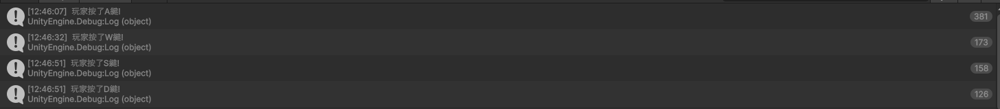
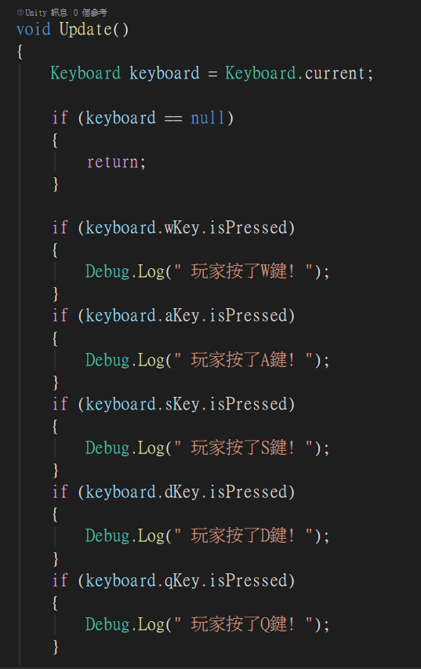
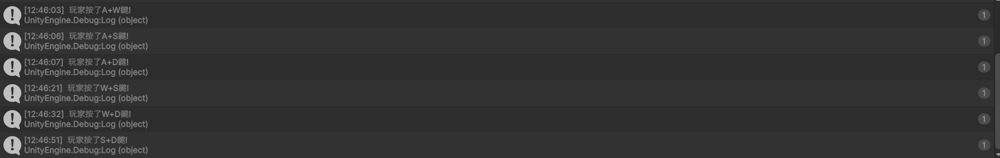
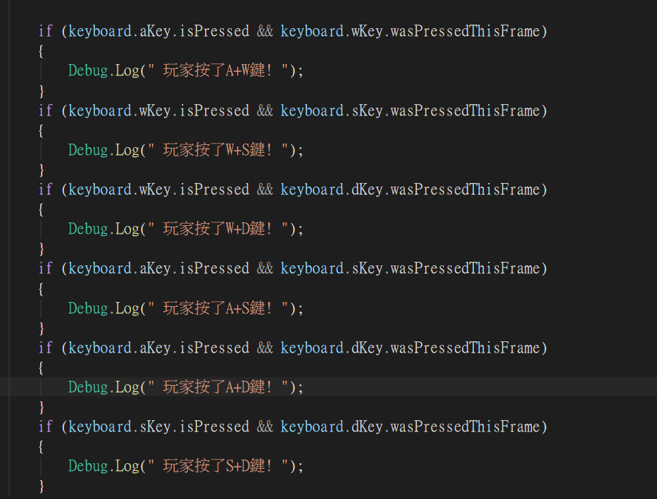

# 第2次作業題目-作業-HW2
>
>學號：113111121
> 
>姓名：邱怡瑄
> 
>作業撰寫時間：30mix
> 
>最後撰寫文件日期：2026/10/26
>

1. 

    a.

Ans:

這是我執行成功後的Console顯示

(13) 每一幀執行一次
     遊戲中大部分邏輯都在這裡
(15) 取得現在鍵盤的狀態
(17) 如果鍵盤裝置等於空值
(19) 結束目前的函式
(22) 偵測玩家有沒有按W鍵
(24) 玩家按了W鍵
(26) 偵測玩家有沒有按A鍵
(28) 玩家按了A鍵
(30) 偵測玩家有沒有按S鍵
(32) 玩家按了S鍵
(24) 偵測玩家有沒有按D鍵
(36) 玩家按了D鍵
我把ϵ替換成了Q鍵
(38) 偵測玩家有沒有按Q鍵
(40) 玩家按了Q鍵

    b. 

Ans:

這是我執行成功後的Console顯示

(44) 偵測玩家是否按下了A+W鍵
(46) 玩家按了A+W鍵!
(48) 偵測玩家是否按下了W+S鍵
(50) 玩家按了W+S鍵!
(52) 偵測玩家是否按下了W+D鍵
(54) 玩家按了W+D鍵!
(56) 偵測玩家是否按下了A+S鍵
(58) 玩家按了A+S鍵!
(60) 偵測玩家是否按下了A+W鍵
(62) 玩家按了A+W鍵!
(64) 偵測玩家是否按下了A+D鍵
(66) 玩家按了A+D鍵!
(68) 偵測玩家是否按下了S+D鍵
(70) 玩家按了S+D鍵!

## 其他
做了那麼多種按鍵，我覺得最容易出錯的地方就是，有沒有修改對按鍵。因為按鍵一多，對我來說都會沒改到，或是改錯字母。